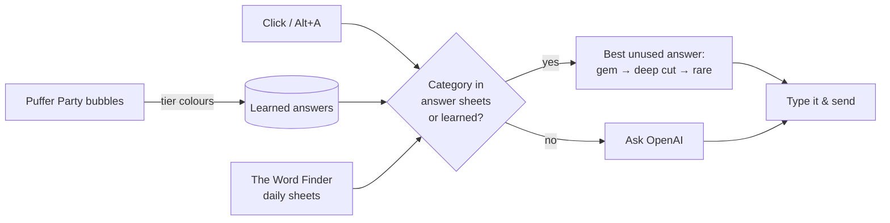

<div align="center">

# 🐡 Krillion Puffer Party / Daily Dive Auto Answer

**One click. One answer. Straight from the sheet.**

A tiny Tampermonkey userscript for [Krillion](https://krillion.io) that answers the current prompt for you, in both the **Daily Dive** and **Puffer Party**, picking the rarest answer that hasn't been used yet.

[](https://raw.githubusercontent.com/YOUR-USERNAME/krillion-auto-answer/main/krillion-auto-answer.user.js)
[](https://github.com/YOUR-USERNAME/krillion-auto-answer/stargazers)
[](krillion-auto-answer.user.js)
[](LICENSE)

[Install](#-installation) · [Usage](#-usage) · [How it works](#-how-it-works) · [Settings](#%EF%B8%8F-settings) · [FAQ](#-faq) · [Report a bug](https://github.com/YOUR-USERNAME/krillion-auto-answer/issues/new/choose)

</div>

---

## ✨ Features

| | |
|---|---|
| 🌟 **Goes for the gem** | Uses Krillion's own answer sheets to pick the **One in a Krillion** when it's still available |
| 🏮 **Then the best of the rest** | Falls back to a **Deep Cut**, then a random short **Rare**, so answers are both high-scoring and accepted |
| 🧠 **Learns while you play** | In Puffer Party every answer bubble is coloured by tier, so the script remembers which answers scored what, per category |
| 🚫 **Never repeats** | Tracks what everyone in the room has already said this category, including plurals and accents |
| 🤖 **AI fallback** | Unknown category? Asks OpenAI for valid, moderately uncommon answers, with adjustable nicheness |
| ⌨️ **Types like a human** | Types character by character with randomised timing, then sends |
| 🫥 **Low-key UI** | A small dot pinned to the right end of the answer box, plus a faint list of suggestions in the top-right corner |

## 📦 Installation

1. Install the **[Tampermonkey](https://www.tampermonkey.net/)** browser extension (Chrome, Firefox, Edge, Safari, Opera).
2. **[Click here to install the script](https://raw.githubusercontent.com/YOUR-USERNAME/krillion-auto-answer/main/krillion-auto-answer.user.js)**. Tampermonkey opens an install page; click **Install**.
3. Open [krillion.io](https://krillion.io). The first time, Tampermonkey asks whether the script may connect to `thewordfinder.com` (the answer sheets) and `api.openai.com`. Choose **Always allow domain**.
4. *(Optional)* Add an OpenAI API key for the AI fallback: click the Tampermonkey icon, choose **Krillion Puffer Party / Daily Dive Auto Answer**, then **Set OpenAI API key**.

> [!TIP]
> In Chrome, also turn on **Allow user scripts** (or **Developer mode** on older versions) under `chrome://extensions` → Tampermonkey → Details, or userscripts won't run.

Updates install automatically through Tampermonkey.

## 🎮 Usage

| Action | How |
|---|---|
| Answer the current prompt | Click the **dot** above the right end of the answer box, or press **Alt + A** |
| Peek at suggestions | Hover over the faint list in the **top-right corner** |
| See the status (category, chosen answer, tier) | Hover over the dot |
| Check what's known about a category | Tampermonkey menu → **Show what is known for this category** |

The dot only acts when the answer box is open, so on your turn in Puffer Party, or while a Daily Dive prompt is running.

### Order it picks in

```
🌟 One in a Krillion  →  🏮 Deep Cut (learned)  →  💎 Rare  →  🐟 Schooler  →  🤖 AI guess
```

## 🔍 How it works



- **Answer sheets:** The Word Finder publishes Krillion's answer sheet for every daily prompt since Oct 28, 2026: the One in a Krillion plus the Plankton, Schooler and Rare lists. The script downloads them once, caches them, and refreshes hourly.
- **Learning:** In Puffer Party, each accepted answer bubble is coloured by its tier. The script records *(category, answer, tier)* in Tampermonkey storage, so categories that never appeared in a daily dive fill up as you play.
- **AI:** Only used when nothing else is known. The prompt asks for real, standard-spelled answers at the rarity level you choose.

## ⚙️ Settings

All settings are in the Tampermonkey menu (click the extension icon while on krillion.io).

| Setting | Default | What it does |
|---|---|---|
| Set OpenAI API key | *(none)* | Needed for the AI fallback and the corner suggestions |
| Set OpenAI model | `gpt-4.1-mini` | Any chat model that supports JSON output |
| Set how niche AI answers are (1-5) | `3` | 1 = common, 5 = very niche |
| Set typing speed (ms/char) | `80` | `0` pastes instantly |
| Reload answer sheets | | Forces a fresh download |
| Show what is known for this category | | Shows the gem and how many answers are known in each tier |

> [!NOTE]
> Your API key and learned answers are stored **only** in your own Tampermonkey storage. They're never in the script file, so they never end up on GitHub.

## ❓ FAQ

<details>
<summary><b>The corner says "not in sheets"</b></summary>

The sheets only cover daily prompts since Oct 28, 2026. Puffer Party also has categories that were never daily prompts. Those use AI until the script has learned answers from a few rounds.
</details>

<details>
<summary><b>It's stuck on "loading sheets…"</b></summary>

The connection permission for `thewordfinder.com` was probably dismissed. Open Tampermonkey → the script → **Settings** → *XHR Security*, allow the domain, then use **Reload answer sheets**.
</details>

<details>
<summary><b>An answer was rejected</b></summary>

Krillion's validator matches answers approximately and its lists are curated, so a correct AI answer can occasionally be missing from them. Sheet answers are taken straight from Krillion's list and should almost always pass. Click again for another answer. A rejected answer is never suggested twice in the same category.
</details>

<details>
<summary><b>Does it work in Unlimited?</b></summary>

Yes, but Unlimited prompts are usually not on the daily sheets, so it mostly uses AI there.
</details>

## ⚖️ Fair play

This is an unofficial fan project and isn't affiliated with Krillion or The Word Finder. Krillion is made by a solo developer, and Puffer Party is played against real people. Please use the script in private rooms with friends who know about it, not to farm wins in public rooms. If the developer asks for it to come down, it will.

## 🤝 Contributing

Issues and pull requests are welcome. If Krillion changes its page layout and the script stops working, [open a bug report](https://github.com/YOUR-USERNAME/krillion-auto-answer/issues/new/choose) and include the page's HTML (in the console, run `copy(document.documentElement.outerHTML)` and paste it into a file).

## ⭐ Star it

If this saved your dive, **[leave a star](https://github.com/YOUR-USERNAME/krillion-auto-answer)** ⭐ It helps other krill find it.

[](https://star-history.com/#YOUR-USERNAME/krillion-auto-answer&Date)

## 📄 License

[MIT](LICENSE)
